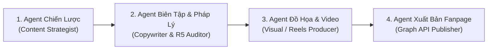

# Workflow: Phòng Fanpage Tự Động (Autonomous Fanpage Agent Team)

> **Mục tiêu:** Vận hành một đội ngũ 4 tác nhân số (Agent Team) tự động sản xuất bài viết đa phương tiện (Text + Ảnh Poster 4:5 hoặc Video ngắn MP4), kiểm định pháp lý quảng cáo (Luật R5) và đẩy trực tiếp lên Facebook Fanpage ở chế độ **Nháp (`draft`)** hoặc **Hẹn giờ (`schedule`)** để người dùng duyệt 1-chạm trước khi lên sóng.

---

## 👥 SƠ ĐỒ TỔ CHỨC ĐỘI NGŨ (4-AGENT TEAM)



1. **Agent 1 — Chiến lược & Lịch Nội dung (Content Strategist)**:
   - Đọc bảng kế hoạch tại [`.agents/knowledge/fanpage_content_calendar.md`](file:///Users/tranhaibang/.gemini/antigravity-ide/scratch/ai-workforce/.agents/knowledge/fanpage_content_calendar.md) qua lệnh `python3 scripts/fanpage_publisher.py next-topic`.
   - Nếu có chủ đề `PENDING` $\rightarrow$ khóa chủ đề, xác định nhóm ngành (`category`), định dạng (`image` hoặc `video`) và mục tiêu CTA.
   - Nếu hàng đợi trống (`EMPTY_QUEUE`) hoặc người dùng đưa chủ đề trực tiếp $\rightarrow$ dùng `search_web` nghiên cứu số liệu/xu hướng mới nhất và lập `facts_evidence.md`.
2. **Agent 2 — Biên tập Nội dung & Kiểm toán Pháp lý R5 (Copywriter & Legal Auditor)**:
   - Thực thi quy trình của kỹ năng [`viet-bai`](file:///Users/tranhaibang/.gemini/antigravity-ide/scratch/ai-workforce/.agents/skills/viet-bai/SKILL.md) cho kênh `facebook`:
     - Mở đầu bằng tình huống thực tế hoặc con số có nguồn.
     - Trình bày gãy gọn, không sáo rỗng AI (`anti_ai_footprint.md`).
     - Chạy bộ lọc tự động `fact_checker.py --channel facebook` và `claim_guard.py --profile ads` đạt **Exit Code = 0**.
3. **Agent 3 — Sản xuất Đa phương tiện (Visual & Video Producer)**:
   - **Nếu `media_type == image`**: Chạy `python3 scripts/fanpage_publisher.py render-card` (hoặc kỹ năng `thiet-ke`) để tạo ảnh Poster Facebook tỷ lệ `4:5` (`1080×1350`) sắc nét có tiêu đề, 3 điểm cốt lõi và thanh CTA.
   - **Nếu `media_type == video`**: Chạy pipeline của kỹ năng [`video-studio`](file:///Users/tranhaibang/.gemini/antigravity-ide/scratch/ai-workforce/.agents/skills/video-studio/SKILL.md) hoặc [`hand-drawn-animation`](file:///Users/tranhaibang/.gemini/antigravity-ide/scratch/ai-workforce/.agents/skills/hand-drawn-animation/SKILL.md) để xuất video MP4 kèm thuyết minh/nhạc nền.
4. **Agent 4 — Quản trị Đăng bài & Lên lịch Fanpage (Fanpage Publisher)**:
   - Chạy `python3 scripts/fanpage_publisher.py publish` để:
     - Quét chốt chặn Luật R5 lần cuối.
     - Tạo giao diện xem trước trực quan `fanpage_preview.html` và script đẩy nhanh `publish_to_fb.sh`.
     - Đẩy lên Facebook Graph API v21.0 ở chế độ **`draft`** (mặc định) hoặc **`schedule`** (nếu đã cấu hình `FB_PAGE_ID` & `FB_PAGE_ACCESS_TOKEN` trong `.env`).
     - Cập nhật trạng thái chủ đề trong `fanpage_content_calendar.md` thành `DRAFT_READY` hoặc `SCHEDULED`.

---

## ⚙️ QUY TRÌNH THỰC THI TỰ ĐỘNG (STEP-BY-STEP)

### Bước 1: Lấy Chủ đề & Khởi tạo Không gian Nháp
```bash
python3 scripts/fanpage_publisher.py next-topic
```
- Tạo thư mục nháp `<process_dir>` tại `_process/fanpage_<id_hoac_ngay>/` và thư mục thành phẩm `<output_dir>` tại `~/Downloads/AIWF_Output/fanpage_<id_hoac_ngay>/`.

### Bước 2: Nghiên cứu Sự thật & Soạn Bài đăng Facebook
1. Dùng `search_web` (hoặc tài liệu nguồn) thu thập tối thiểu 2 dẫn chứng/số liệu xác thực, lưu vào `<process_dir>/facts_evidence.md`.
2. Soạn thảo bài đăng tại `<process_dir>/post_draft.md` theo chuẩn kênh `facebook` (câu ngắn $\le 30$ từ, đoạn 2–4 câu, có nguồn cùng dòng `(Theo <Đơn vị>, <Năm>)`, kết bài có 1 lời mời hành động rõ ràng).
3. Kiểm định bắt buộc:
   ```bash
   python3 .agents/skills/viet-bai/scripts/fact_checker.py \
     --input "<process_dir>/post_draft.md" \
     --category <category> \
     --channel facebook
   ```
   *(Nếu Exit Code != 0, Agent tự động chỉnh sửa cho đến khi đạt Exit Code = 0).*

### Bước 3: Sản xuất Ấn phẩm Hình ảnh / Video Đi kèm
- **Trường hợp Bài đăng kèm Ảnh Poster (`image`)**:
  ```bash
  python3 scripts/fanpage_publisher.py render-card \
    --title "<Tiêu đề ngắn gọn ≤ 12 từ>" \
    --bullets "<Ý chính 1>" "<Ý chính 2>" "<Ý chính 3>" \
    --cta "<Câu kêu gọi hành động>" \
    --tag "<NHÃN CHỦ ĐỀ>" \
    --theme pastel \
    --output "<process_dir>/social_card.png"
  ```
- **Trường hợp Bài đăng kèm Video ngắn (`video`)**:
  - Tạo kịch bản `<process_dir>/video_script.json` và gọi `video-studio` xuất `<process_dir>/social_video.mp4`.

### Bước 4: Đóng gói, Tạo Bản Xem Trước & Đẩy lên Fanpage (Chế độ Nháp / Lên lịch)
```bash
python3 scripts/fanpage_publisher.py publish \
  --post-file "<process_dir>/post_draft.md" \
  --media "<process_dir>/social_card.png" \
  --mode draft \
  --out-dir "$HOME/Downloads/AIWF_Output/fanpage_<id_hoac_ngay>"
```
- Sau khi lệnh trả về Exit Code 0, nếu bài lấy từ `fanpage_content_calendar.md`, cập nhật trạng thái:
  ```bash
  python3 scripts/fanpage_publisher.py mark-status --id "<FP-ID>" --status DRAFT_READY
  ```

---

## 🔐 HƯỚNG DẪN KẾT NỐI FACEBOOK GRAPH API (1 LẦN DUY NHẤT)

Để Agent đẩy thẳng bài vào mục **Bản nháp (Drafts)** hoặc **Bài viết đã lên lịch (Scheduled Posts)** trên Meta Business Suite của Fanpage, bạn chỉ cần tạo file `.env` ở thư mục gốc `ai-workforce/.env` (file này đã được `.gitignore` bảo vệ tuyệt đối, không bao giờ lộ lên Git):

```ini
FB_PAGE_ID="123456789012345"
FB_PAGE_ACCESS_TOKEN="EAABsbCS1iHgBO..."
FB_PAGE_NAME="Tên Fanpage Của Bạn"
```
> 💡 **Ngay cả khi bạn chưa điền `.env`**, Agent Team vẫn chạy trọn vẹn 100% quy trình, xuất sẵn ảnh/video, bài viết, giao diện xem trước `fanpage_preview.html` và tạo sẵn file bấm chạy 1-chạm `publish_to_fb.sh` trong `~/Downloads/AIWF_Output/`.

---

## 🛡️ CỔNG KIỂM ĐỊNH KÉP BẮT BUỘC (Rule R3 §9)
- **Thẩm định Kỹ thuật:**
  - [ ] `fact_checker.py --channel facebook` và `claim_guard.py --profile ads` đạt Exit Code = 0.
  - [ ] File ảnh `social_card.png` (hoặc video `.mp4`) được kiểm tra bằng mắt qua `view_file` (không tràn chữ, bố cục cân đối).
  - [ ] File `post_manifest.json` và `fanpage_preview.html` được tạo đầy đủ trong `<output_dir>`.
- **Thẩm định Trải nghiệm:**
  - [ ] Toàn bộ thành phẩm nằm gọn trong `~/Downloads/AIWF_Output/fanpage_<id_hoac_ngay>/`.
  - [ ] Không phát sinh file rác trong gốc repository.
